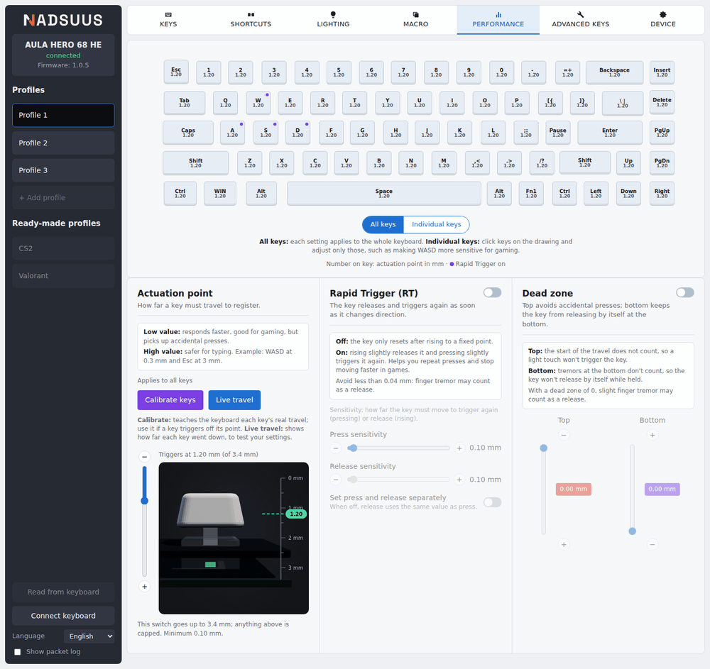

# Aula HERO Configurator

**Free, open-source software to configure Aula HERO magnetic (Hall effect) keyboards** — actuation point, Rapid Trigger, dead zone, key remapping, macros, RGB lighting and more. Runs as a Windows app or directly in Chrome/Edge, with no account and no install.

[](https://github.com/nadsuus/aula-hero-configurator/releases)
[](https://nadsuus.github.io/aula-hero-configurator/)
[](LICENSE)

[Português](#português) · [Download](https://github.com/nadsuus/aula-hero-configurator/releases) · [Use online](https://nadsuus.github.io/aula-hero-configurator/) · [Report a bug](https://github.com/nadsuus/aula-hero-configurator/issues/new/choose)

<picture>
  <source media="(prefers-reduced-motion: reduce)" srcset="docs/screenshot.png">
  
</picture>

> Unofficial project, not affiliated with Aula. It talks to the keyboard with the same USB protocol as the official web configurator (hero.aulastar.com).

## Features

- **Performance (Hall effect):** actuation point per key or for the whole keyboard, **Rapid Trigger** with separate press/release sensitivity, top and bottom **dead zone**, **live key travel** and **key calibration**. A 3D keycap shows the chosen actuation depth in mm.
- **Key remapping:** change what each key does on the normal, Fn and Fn1 layers (keys, mouse, media, shortcuts). Pick a key by clicking the drawing or pressing it.
- **Advanced keys:** DKS, mod-tap (hold/tap), toggle, **SOCD** (snap tap), multi-point (MPT) and on-release (END), up to 40 per profile.
- **Macros:** record keys with real timing, edit steps and delays (up to 150 steps), run N times, while held or on repeat.
- **Fn shortcuts:** hold Fn + a key to type symbols the 68-key layout lacks (useful on Brazilian ABNT Windows layouts) or any Ctrl/Shift/Alt/AltGr/Win combo.
- **RGB lighting:** effect, color (picker, RGB or hex), multicolor, brightness and speed for key lights and the light bar, with a live preview; per-key colors in the Custom effect.
- **Profiles:** the keyboard's 3 onboard profiles plus your own and ready-made CS2 and Valorant profiles.
- **Device:** polling rate, sleep, Mac mode, Windows key lock.
- **Languages:** English and Portuguese (Brazil). Keyboard-accessible, with light and dark themes.

It deliberately does **not** touch firmware or factory reset.

## Supported keyboards

Models recognized by the app (from the official configurator's model table):

| Line | Models |
|---|---|
| 68 keys | HERO 68 HE, 68 HE NEO, 68 HE wireless, 68 AIR, 68 MINI, 68 HE JIS, WIN68HE Ultra |
| 84 keys | HERO 84 HE, 84 HE JIS |
| 87 keys | HERO 87 HE |
| 99 keys | HERO 99, 99 HE |
| 100 keys | HERO 100 |

Not every model has been tested on real hardware. If yours works (or doesn't), please [open an issue](https://github.com/nadsuus/aula-hero-configurator/issues/new/choose) with the model and firmware version.

**Requirements:** connect the keyboard **with the USB cable** (the 2.4 GHz receiver is not supported) and close the official website first — two programs talking to the keyboard at once scramble the replies.

## Getting started

### Option 1: use it online (Chrome or Edge)

Open **https://nadsuus.github.io/aula-hero-configurator/**, click **Connect keyboard** and pick the Aula from the list. It uses WebHID, so it needs Chrome, Edge or another Chromium browser (Firefox and Safari don't support WebHID). Tested on Windows.

### Option 2: Windows app

Download the installer (`.exe`) from [Releases](https://github.com/nadsuus/aula-hero-configurator/releases). It installs per user, without admin rights. The installer is not code-signed yet, so Windows SmartScreen may warn: click **More info** → **Run anyway**.

### Option 3: run from source

```sh
git clone https://github.com/nadsuus/aula-hero-configurator
cd aula-hero-configurator

# Web version: serve the web folder and open http://localhost:8765 in Chrome/Edge
python3 -m http.server 8765 --bind 127.0.0.1 --directory web

# Windows app (needs Rust + Visual Studio C++ tools, and: cargo install tauri-cli --version "^2" --locked)
cargo tauri dev     # run in development mode
cargo tauri build   # build the installer in src-tauri/target/release/bundle/nsis/
```

## How it works

| File | What it does |
|---|---|
| `web/index.html` | The interface (plain HTML, CSS and JavaScript, no framework or build step) |
| `web/protocol.js` | The keyboard protocol: packet format, checksum and every command, commented |
| `web/transport.js` | How packets reach the keyboard: WebHID in the browser, Rust in the app |
| `web/layouts.js`, `web/keycodes.js` | Key positions per model and key function codes, taken from the official configurator |
| `web/i18n.js` | Translations and the language picker |
| `web/keycap3d.js` | The 3D keycap on the Performance tab (Three.js, MIT, bundled in `web/vendor/`) |
| `src-tauri/` | The Windows app (Tauri 2); `src/main.rs` talks to USB through hidapi |

## Contributing

Bug reports and support for new models are welcome: use the [issue forms](https://github.com/nadsuus/aula-hero-configurator/issues/new/choose). For code changes, open a pull request describing what you changed and how you tested it (ideally on a real keyboard).

## Disclaimer

Personal, unofficial project with no connection to Aula. Made for interoperability with keyboards the user owns. Use at your own risk. "Aula" and "HERO" are trademarks of their respective owner. Model names, key positions and key function codes come from the manufacturer's public configurator.

## License

[MIT](LICENSE) for this project's code. Three.js is bundled under its own MIT license (`web/vendor/three-LICENSE.txt`).

---

## Português

**Configurador gratuito e de código aberto para os teclados magnéticos (Hall effect) Aula HERO** — ponto de acionamento, Rapid Trigger, zona morta, remapeamento de teclas, macros, iluminação RGB e mais. Funciona como app para Windows ou direto no Chrome/Edge, sem conta e sem instalar nada.

- **Usar online:** abra https://nadsuus.github.io/aula-hero-configurator/ no Chrome ou Edge, clique em **Conectar teclado** e escolha o Aula na lista.
- **App para Windows:** baixe o instalador `.exe` em [Releases](https://github.com/nadsuus/aula-hero-configurator/releases). Ele não tem assinatura digital, então o SmartScreen pode avisar: clique em **Mais informações** → **Executar assim mesmo**.
- **Requisitos:** teclado ligado **no cabo USB** (o receptor 2.4G não é suportado) e o site oficial fechado.

O que dá para configurar: ponto de acionamento por tecla ou geral, Rapid Trigger, zona morta, curso ao vivo e calibração; função de cada tecla nas camadas normal, Fn e Fn1; teclas avançadas (DKS, MT, TGL, SOCD, MPT, END); macros; atalhos com Fn para símbolos que faltam no layout ABNT de 68 teclas; iluminação das teclas e da barra de luz (com cor em hexadecimal e cor por tecla); perfis próprios e prontos (CS2 e Valorant); taxa de resposta, suspensão, modo Mac e trava da tecla Windows. A interface tem português e inglês, tema claro e escuro, e funciona pelo teclado.

Projeto pessoal e não oficial, sem ligação com a Aula. Não mexe em firmware nem faz reset de fábrica. Achou um problema ou tem um modelo que ainda não funciona? [Abra uma issue](https://github.com/nadsuus/aula-hero-configurator/issues/new/choose).
